<div align="center">



<br/>


</div>

```bash
$ cat about.md
```

- 🤖 카메라로 보고, 손으로 움직이는 **Physical AI**를 공부하고 있어요
- 👁️ 손·얼굴·제스처 인식부터 실시간 객체 탐지까지, **비전 AI**로 실험 중
- 🎮 배운 걸 바로 써먹으려고 **작은 게임과 웹 서비스**를 만들어요
- 🔧 다음 목표: 비전 모델 + **아두이노**로 진짜 움직이는 것 만들기

```bash
$ ls ./stack
```

<p>


<br/>


</p>

```bash
$ ls ./projects --sort=latest
```

| 프로젝트 | 설명 | 실행 |
|---|---|---|
| 🐱 [cat-dream-story](https://github.com/DIDIDIP/cat-dream-story) | 딱 세 번의 선택으로 아침을 맞는 고양이 꿈 선택지 게임 | [▶ play](https://dididip.github.io/cat-dream-story/) |
| ✋ [palm-reading-ai](https://github.com/DIDIDIP/palm-reading-ai) | 사진 한 장으로 보는 손금 운세 웹 서비스 | [▶ open](https://dididip.github.io/palm-reading-ai/) |
| 🖐️ [mediapipe-hand-landmarker](https://github.com/DIDIDIP/mediapipe-hand-landmarker) | MediaPipe 손 랜드마크 웹캠 데모 | `python` |
| 🔌 [arduino-shop](https://github.com/DIDIDIP/arduino-shop) | 아두이노 & 전자부품 쇼핑몰 데모 (Next.js + Supabase) | `next` |
| 🍉 [fruit-merge-game](https://github.com/DIDIDIP/fruit-merge-game) | 과일 합치기 퍼즐 웹 게임 | [▶ play](https://dididip.github.io/fruit-merge-game/) |
| 🍎 [apple-catch-game](https://github.com/DIDIDIP/apple-catch-game) | 사과 받기 웹 게임 | [▶ play](https://dididip.github.io/apple-catch-game/) |

```bash
$ git log --stat
```

<div align="center">


</div>

<div align="center">

```text
> while (alive) { learn(); build(); commit(); }
```

</div>
