 

## 🎬 About Me

> **키프레임 하나하나로 캐릭터에 생명을 넣던 3D 애니메이터가, 이제 코드로 직접 움직임을 만듭니다.**

- 🕹️ **3D 게임 애니메이터**: 게임 캐릭터의 움직임을 만들어 왔어요
- 🛠️ **게임 애니메이터 개발**로 영역을 넓히는 중: 애니메이션 감각 + 프로그래밍
- 🐍 **Python 미니 앱**을 만들면서 작업을 편하게 해 줄 도구를 직접 만들어 보고 있어요
- 🌱 지금은 K-Digital 피지컬AI 과정에서 Python과 비전 AI를 배우고 있어요

## 🎞️ Portfolio

<table>
  <tr>
    <td align="center" width="50%">
      
       <b>▶ 3D Game Animation Reel 2023</b>
    </td>
    <td align="center" width="50%">
      
       <b>▶ 3D Game Animation Reel · Rememento</b>
    </td>
  </tr>
</table>

## 🧰 Tools

## 🚀 Projects

### 🎮 게임 애니메이터 개발
| 작업 | 내용 | 보기 |
|---|---|---|
| 🎬 3D Game Animation Reel 2023 | 3D 게임 캐릭터 애니메이션 모음 | [▶ YouTube](https://youtu.be/Ujm-raGQAVI) |
| 🎬 Rememento Animation Reel | 3D 게임 애니메이션 릴 「Rememento」 | [▶ YouTube](https://youtu.be/YP4tUX21rO8) |

### 🐍 Mini App for Python
| 프로젝트 | 내용 | 보기 |
|---|---|---|
| 🐱 [cat-dream-story](https://github.com/DIDIDIP/cat-dream-story) | 딱 세 번의 선택으로 아침을 맞는 고양이 꿈 선택지 게임 (tkinter) | [▶ play](https://dididip.github.io/cat-dream-story/) |
| 🖐️ [mediapipe-hand-landmarker](https://github.com/DIDIDIP/mediapipe-hand-landmarker) | 웹캠으로 손 관절 21개를 따라가는 MediaPipe 데모 | `python` |

그 밖의 작은 웹 게임: [🍉 과일 합치기](https://dididip.github.io/fruit-merge-game/) · [🍎 사과 받기](https://dididip.github.io/apple-catch-game/) · [✋ 손금 운세](https://dididip.github.io/palm-reading-ai/)

## 📊 GitHub Stats

🎞️ <i>Keyframe by keyframe, line by line.</i>

